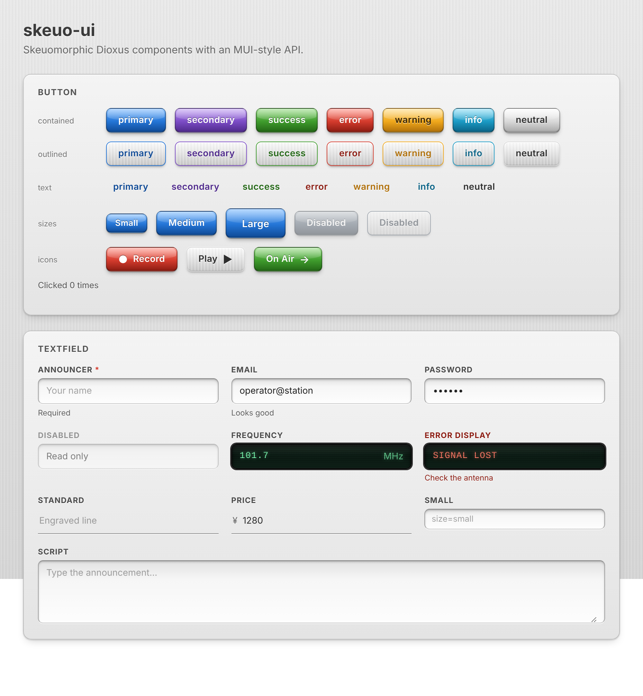
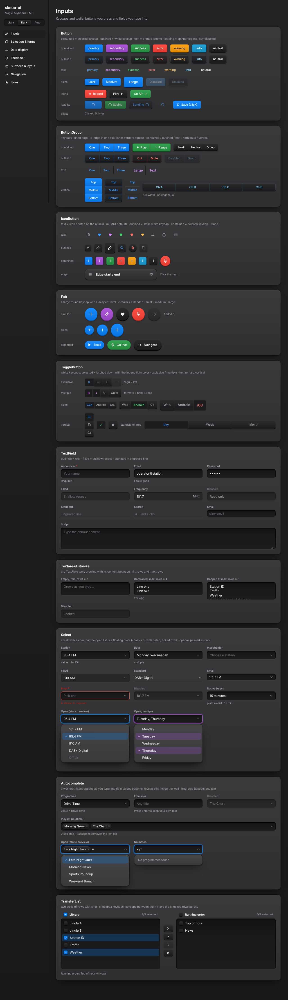

# skeuo-ui

用 Rust（[Dioxus](https://dioxuslabs.com) 0.7）编写的**拟物化** UI 组件库，用来替代 MUI。

- **设计语言：Apple Magic Keyboard，浅色 / 深色（Space Black）两套主题，可跟随系统。** 哑光喷砂铝、低键程平顶键帽、刻进金属的凹槽；无高光、无浮雕字。统一顶部光源。所有组件都由同一套「材质」组合而成，规则见 [`DESIGN.md`](DESIGN.md)。
- **API 对齐 MUI。** 组件名和属性名与 MUI 一致（`variant`、`color`、`size`、`disabled`、`helper_text`、`onchange`……），支持受控 / 非受控。
- **两种实现，外观一致：** Rust（Dioxus，本页）和 **C++20**（[`cpp/`](cpp/README.md)，WebView2 窗口）。两者共用同一份样式表，组件和 API 一一对应。
- **跨平台。** 同一套组件可运行在 Web（WASM）、桌面（Windows / macOS / Linux）和移动端，支持 SSR。样式是纯 CSS，`ThemeProvider` 自动注入。




## 组件

| 分类 | 组件 |
|---|---|
| 输入 Inputs | Button（含 loading）、IconButton、Fab、ButtonGroup、ToggleButton / ToggleButtonGroup、TextField、TextareaAutosize、Select、NativeSelect、Autocomplete、TransferList |
| 选择与表单 Selection | Checkbox、Radio / RadioGroup、Switch、Slider（单值 / 区间 / 刻度 / 竖直）、Rating、FormControl、FormLabel、FormControlLabel、FormGroup、FormHelperText |
| 数据展示 Data display | Typography、Avatar / AvatarGroup、Badge、Chip、Divider、List 全家、Table 全家（含排序）、Tooltip、ImageList |
| 反馈 Feedback | Alert / AlertTitle、Backdrop、Modal、Dialog 全家、CircularProgress、LinearProgress、Skeleton、Snackbar |
| 容器与布局 Surfaces & layout | Paper、Card 全家、Accordion 全家、AppBar、Toolbar、Drawer、SkeuoBox（即 MUI `Box`）、Container、Stack、Grid（v2） |
| 导航 Navigation | Tabs / Tab / TabPanel、Breadcrumbs、Link、Menu / MenuItem / MenuList、Popover、Pagination、Stepper 全家、MobileStepper、BottomNavigation、SpeedDial、Timeline |
| 其他 | Icon（40 个内置图标）、ThemeProvider / Theme（对应 `createTheme`） |

与 MUI 的差异：每个组件的文档注释里都写明了（例如 Select 的选项以数据传入而不是 `MenuItem` 子元素；MUI 的 `Box` 改名为 `SkeuoBox`，以免遮蔽 Rust 的 `Box`）。

## 使用

```rust
use dioxus::prelude::*;
use skeuo_ui::prelude::*;

fn App() -> Element {
    let mut name = use_signal(String::new);
    let mut on_air = use_signal(|| false);
    rsx! {
        // 相当于 MUI 的 ThemeProvider + CssBaseline，在应用最外层包一次即可
        ThemeProvider {
            TextField {
                label: "Name",
                value: name(),
                oninput: move |e: FormEvent| name.set(e.value()),
            }
            FormControlLabel {
                control: rsx! { Switch { checked: on_air(), onchange: move |e: FormEvent| on_air.set(e.checked()) } },
                label: "On air",
            }
            Button { onclick: move |_| save(), "Save" }
        }
    }
}
```

### 浅色 / 深色主题

两套外观：**浅色**（银色铝 + 白色键帽）和 **深色 Space Black**（深色铝 + 黑色键帽，浅灰字符）。

```rust
ThemeProvider { theme: Theme::default(), … }   // 浅色（默认）
ThemeProvider { theme: Theme::dark(), … }      // 深色
ThemeProvider { theme: Theme::system(), … }    // 跟随系统（prefers-color-scheme）

// 运行时切换：把模式放进 signal
let mut mode = use_signal(|| ThemeMode::System);
rsx! { ThemeProvider { theme: Theme::default().with_mode(mode()), … } }
```

### 自定义主题（相当于 `createTheme`）

浅色和深色各有一套调色板，可以分别修改：

```rust
let mut theme = Theme::system();
// light（亮色，深色模式下的文字色）/ main（键帽颜色）/ dark（键帽侧边）/ 键帽文字色 / 焦点光晕
theme.light.primary = PaletteColor::new("#ff9f0a", "#c93400", "#8f2500", "#fff", "rgba(201,52,0,.35)");
theme.dark.primary  = PaletteColor::new("#ffb340", "#ff9f0a", "#a35f00", "#1d1d1f", "rgba(255,159,10,.45)");
theme.radius = 6.0;
rsx! { ThemeProvider { theme, /* … */ } }
```

## 示例程序（Gallery）

```bash
# Windows 桌面版（在 Linux 上交叉编译，生成 dist/skeuo-ui-gallery-windows-x64.zip）
./scripts/build-windows.sh

# 在本机桌面运行（Windows / macOS 直接可用；Linux 需要 webkit2gtk）
cargo run -p gallery --no-default-features --features desktop

# 浏览器运行（需要 dioxus-cli）
dx serve -p gallery

# 不需要任何工具链：把每个页面渲染成静态 HTML
cargo run -p gallery --example snapshot -- snapshots/
```

## 开发

```bash
cargo test --workspace     # 各分类的 SSR 渲染测试
cargo clippy --workspace --all-targets
```

## 目录

```
DESIGN.md                    设计语言与材质规范
crates/skeuo-ui/
  assets/tokens.css          设计变量（颜色、圆角、动效）
  assets/materials.css       材质：键帽 / 凹槽 / 轨道 / 铝面板 / 刻线 / 指示灯
  assets/dark.css            深色主题（Space Black）的设计变量
  assets/<分类>.css          各分类组件样式
  src/<分类>/                组件源码（inputs, selection, data_display, feedback, surfaces, navigation）
  tests/<分类>.rs            测试
crates/gallery/              示例程序（每个分类一个页面）
scripts/build-windows.sh     Windows 打包脚本（Rust 版）
scripts/build-windows-cpp.sh Windows 打包脚本（C++ 版）
cpp/                         C++20 版本（见 cpp/README.md）
design/                      设计稿（toggle-switch.cdr）
```
